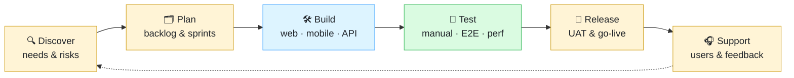

  

  
  
  

## 👋 About me

I don't just write code, and I don't just test it. **I take products from the first requirement to production**, and I wear three hats along the way: developer, project lead and QA engineer.

Today I'm a **Developer & IT Support engineer at NFC Bank**, building internal tools that automate business processes and reporting. Before that, I spent **2+ years as a QA Engineer**, and I've designed, built and delivered web, mobile and desktop products for clients in **Cameroon and the UK**.

## 🎯 What I bring

<table>
  <tr>
    <th width="33%">🛠️ Build</th>
    <th width="33%">🧭 Lead</th>
    <th width="33%">🧪 Test</th>
  </tr>
  <tr valign="top">
    <td>
      • Web apps & admin portals 
      • REST & real-time APIs 
      • Mobile apps (Flutter, Expo) 
      • Desktop apps (Tauri) 
      • Internal tools & automation
    </td>
    <td>
      • Turn business needs into specs and user stories 
      • Plan and prioritize the backlog 
      • Coordinate developers, designers and clients 
      • Run demos, UAT and releases
    </td>
    <td>
      • Test strategy, test cases, traceability 
      • E2E & API automation (Cypress) 
      • Performance testing (k6) 
      • Defect triage and go / no-go calls
    </td>
  </tr>
</table>

## 🚀 Featured work

My role on each project: 🛠️ Build · 🧭 Lead · 🧪 Test &nbsp;|&nbsp; 🔒 private repository

| Project | What it is | Role | Stack |
|---|---|:---:|---|
| **CarerPoint** 🔒 | Home-care management platform for UK agencies: admin portal, field-carer mobile app (GPS check-in, eMAR, biometrics), family portal, API, docs and a shared design system | 🛠️ 🧭 🧪 | NestJS · Nuxt 4 · Flutter · PostgreSQL · Bun |
| **[ITSER](https://itser.co.uk)** 🔒 | Bilingual website and admin back-office for a UK digital agency, including billing and invoicing | 🛠️ 🧭 🧪 | Astro · Node.js · Bun · Stripe |
| **Pressing Manager** 🔒 | Desktop app to run a dry-cleaning business: order lifecycle, CRM with QR codes, dynamic pricing, financial reports, role-based access | 🛠️ 🧭 🧪 | Tauri · React · Bun · Prisma · SQLite |
| **Metron** 🔒 | Offline-first water-billing app for boreholes and rental properties: meter readings, invoices, payments and debts | 🛠️ 🧭 🧪 | Flutter · Riverpod · Supabase · PowerSync |
| **[MySky](https://github.com/skia-dac/mysky)** | Organization app for students (Android & iOS): timetables, homework, exams & grades, calendar, focus mode | 🛠️ 🧭 🧪 | Expo · TypeScript · Supabase · Jest |
| **Wi-Fi captive portal** 🔒 | Rewrite of a hotspot portal: plans, vouchers, branding, SMS verification and i18n on a legacy RADIUS stack | 🛠️ 🧪 | PHP · CoovaChilli · RADIUS |
| **[Charity website](https://github.com/skia-dac/association)** | Bilingual (EN/FR) website MVP for non-profits | 🛠️ | React · Vite · Tailwind CSS · Express |

> Private projects are client or product work. Happy to walk you through them in a demo.

## 🔁 How I deliver

## 📊 QA track record

- ✅ **2,500+ test cases** written and executed across 4 web and 2 mobile apps (Jira + Zephyr Scale)
- 🤖 **100+ end-to-end UI & API regression scenarios** automated with Cypress
- ⚡ **API load tests** with Grafana k6, simulating **1,000+ concurrent users**
- 🐞 **750+ defects** found, documented and followed through to resolution

## 🧰 Tech stack

**Front-end** 

**Back-end & data** 

**Mobile & desktop** 

**Quality & delivery** 

## 🤝 Community

- 🧪 Member of **Cypress Cameroon**, the local testing community
- 💙 Founding member of **[Keep Sharing](https://keep-share.org)**, a non-profit supporting vulnerable children and families in Cameroon

<b>💼 Experience & education</b>

 

| Role | Company | Period |
|---|---|---|
| Developer & IT Support | NFC Bank | Sep 2026 – present |
| QA Engineer | Synergy Consulting (digital health) | Jun 2026 – Sep 2026 |
| QA Engineer | RANITES | Feb 2024 – Apr 2026 |
| Mobile Application Developer (intern) | BITS | 2021 |

🎓 Bachelor's degree in Software Engineering · IUC

---

<b>Got a product to build, a project to steer or a release to secure? Let's talk.</b>

